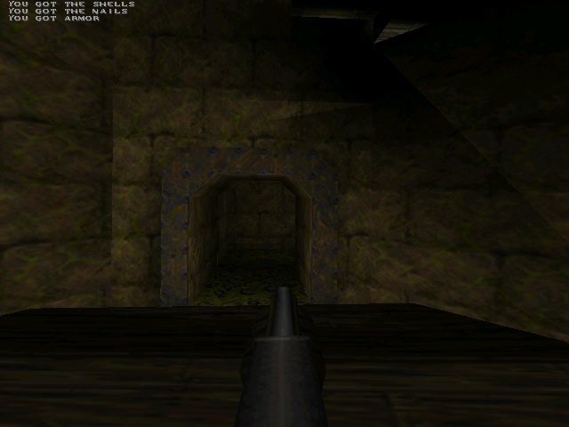
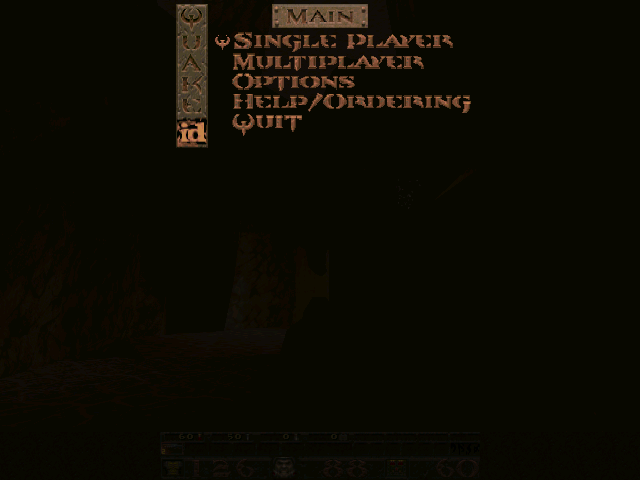
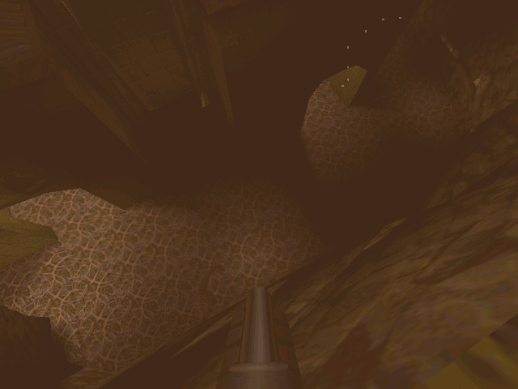

# Quake

**id Software's 1996 shooter, native on the Amiga, software and OpenGPU builds.**

  

  
  

Captured from this build running on AmigaOS.

Quake on the Amiga, built from Frank Wille and Steffen Häuser's Amiga Quake 2.30 sources with a new ACGame system layer: the software renderer on AGA or RTG at around 40 frames a second, and OpenUpQuake, id's GLQuake drawn through MiniGL on OpenGPU.

## What you need

A 68040 or 68060 with an FPU, AmigaOS 3.2 or later, AHI. AGA or RTG for the software build; RTG and OpenGPU for OpenUpQuake.

Game data is not included. Put `id1/pak0.pak` (the shareware or the full game) in the Quake drawer.

## Controls

| Key | Does |
|---|---|
| Arrows / mouse | Move and look |
| Ctrl / left mouse | Fire |
| Space | Jump |
| 1-8 | Weapons |
| ~ | Console |
| Esc | Menu |

## What works

- `timedemo demo1`: 39.7 fps on RTG, 47.9 fps on AGA (lab 68040)
- Sound through AHI, the console, the menus, mouse look
- OpenUpQuake: 640x480 GL on OpenGPU

## Not in this build yet

- CD audio and the network (null drivers)
- The 68k assembly routines (they need vasm, not yet in the toolchain)

## Building

The Amiga build, its make file and what was changed for the 68k are described in [AMIGA_PORT.md](AMIGA_PORT.md).

## Credits and licence

Quake by id Software; Amiga Quake 2.30 by Frank Wille and Steffen Häuser ([upstream](https://github.com/id-Software/Quake)). Licence: GPL 2.

Amiga port by The AmiCradle Team.
